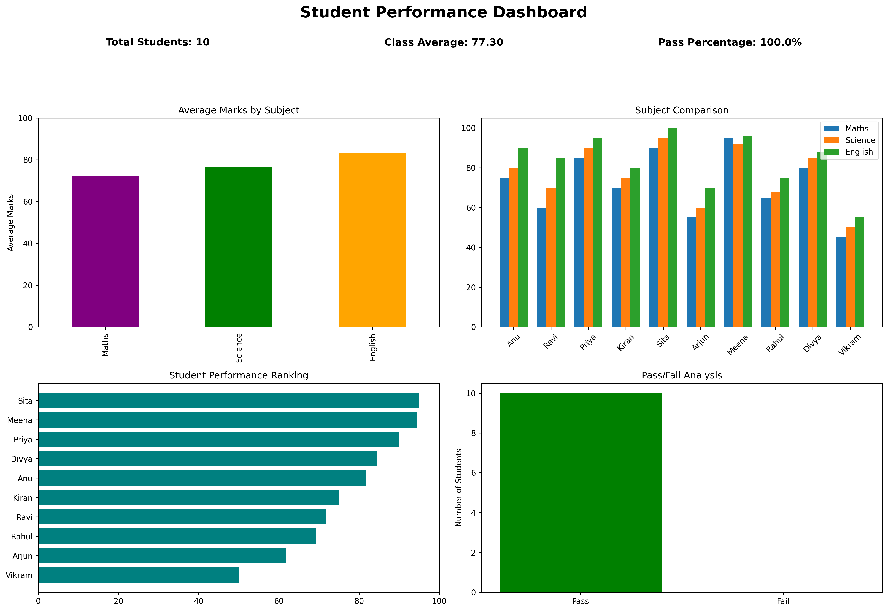

# Student Performance Visualization Dashboard

A Python-based data analysis and visualization project that explores student academic performance across Maths, Science, and English using NumPy, Pandas, and Matplotlib.

## Project Overview

This project analyzes the academic performance of 10 students. It calculates total and average marks, classifies students based on their performance, ranks students, and visualizes the results through an interactive-style dashboard of charts.

## Technologies Used

- **Python** – Core programming language
- **NumPy** – Numerical operations and conditional classification
- **Pandas** – Data manipulation and analysis
- **Matplotlib** – Data visualization
- **Google Colab** – Development environment

## Features

- Dataset creation and inspection
- Statistical analysis of subject-wise marks
- Calculation of total and average marks
- Student performance classification:
  - Excellent: Average ≥ 75
  - Good: Average ≥ 60
  - Pass: Average ≥ 40
  - Fail: Average < 40
- Student ranking based on average marks
- Subject-wise performance comparison
- Pass/fail analysis
- Box plot analysis for identifying potential outliers
- Combined dashboard with summary metrics

## Dashboard Preview



## Key Findings

Based on the sample dataset:

- Total students: 10
- Class average: 77.30
- Pass percentage: 100%
- Highest subject average: English (83.4)
- Lowest subject average: Maths (72.0)
- Top-performing student: Sita (95.0 average)
- Lowest-performing student: Vikram (50.0 average)
- No outliers detected using the 1.5 × IQR rule in the three subject distributions.

## Project Files

```text
Student-Performance-Dashboard/
│
├── student_performance_dashboard.png
├── student_performance_results.csv
├── student_performance_dashboard.ipynb
└── README.md
```

## How to Run

1. Clone or download this repository.
2. Open `student_performance_dashboard.ipynb` using Google Colab or Jupyter Notebook.
3. Install the required libraries if they are not already available:

```bash
pip install numpy pandas matplotlib
```

4. Run the notebook cells in order.
5. View the generated dashboard and processed CSV file.

## What I Learned

Through this project, I practised:

- Creating and manipulating NumPy arrays.
- Working with Pandas DataFrames.
- Inspecting and summarizing datasets.
- Applying vectorized calculations and conditional operations.
- Understanding statistical measures such as mean, median, quartiles, and IQR.
- Creating line charts, bar charts, histograms, and box plots.
- Combining multiple visualizations using Matplotlib subplots.
- Building a complete data analysis workflow.

## Future Improvements

- Allow users to upload their own student datasets.
- Add interactive filters for students and subjects.
- Build a web-based dashboard using Streamlit.
- Support larger datasets and additional academic metrics.

---

**Project:** Student Performance Visualization Dashboard  
**Status:** Completed  
**Domain:** Data Analysis and Visualization